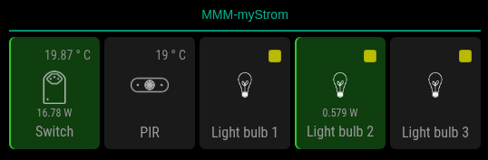
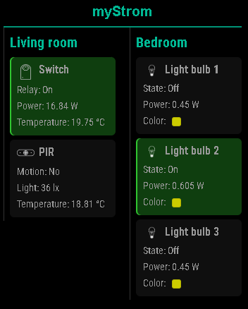

# MMM-myStrom
MMM-myStrom is a [MagicMirror²](https://github.com/MagicMirrorOrg/MagicMirror) module for monitoring [myStrom](https://mystrom.ch/) smart home devices (Switch, Bulb, PIR).
It supports room grouping, light and full layout modes, alert sounds, email notifications, and live power/motion tracking.

## Features
- Automatic device type detection (PIR / Switch / Bulb)
    - PIR values: Motion (YES/NO), Ambient light (lx), Room temperature (°C)
    - Switch values: Relay ON/OFF, Power usage (W), Room temperature (°C)
    - Bulb values: On/off state, Power, Light color
- Multi-room layouts: `column` (hierarchical), `showRoomSideBySide`, `inline` (compact grid) and `light`
- Per-type update interval settings
- Alert system:
    - On → Off
    - Off → On
    - Power above threshold
    - Power normalized
    - PIR motion cleared
    - Custom alert sounds (per device or per type)
    - Email notifications using SMTP
- Multi-language support: i18n for EN, DE, FR, IT


## Screenshot






## Installation

### Install
```bash
cd ~/MagicMirror/modules
git clone https://github.com/ch1ledbe/MMM-myStrom
cd MMM-myStrom
npm install --omit=dev
```
Your sound files go in:
```bash
MMM-myStrom/sounds/
```
### Upgrade
HINT: The upgrade command is not available in versions below 1.1.0. A complete new installation must be carried out instead.
```bash
npm run upgrade
```
The upgrade runs `git pull --ff-only` and `npm install`. Your own sound files and `secrets.json` are kept. If you changed files of the module itself, git stops the upgrade instead of overwriting them.

## Configuration

To use this module, you have to add a configuration object to the modules array in the `config/config.js` file.

### Example configuration

Minimal configuration to use the module:

```js
    {
        module: "MMM-myStrom",
        position: "bottom_center",
        config: {
            devices: [
                {
                    room: "Room 1",
                    devices: [
                        { name: "Device 1", ip: "192.168.1.11" },
                    ]
                }
            ]
        }
    },
```

Configuration with all options:

```js
    {
        module: "MMM-myStrom",
        position: "bottom_center",
        config: {
            layout: "column",
            showRoomSideBySide: false,
            displayMode: "light",
            PIRUpdateInterval: 30000,
            SwitchUpdateInterval: 2000,
            BulbUpdateInterval: 2000,
            alertEnabled: true, 
            powerThresholds: {
                SWITCH: 100,
                BULB: 4 
            },
            alertFiles: {
                PIR: "pirSound.mp3",
                SWITCH: "switchOn.mp3",
                BULB: "bulbOn.mp3"
            },
            alertFilesOff: {
                PIR: "pirOff.mp3",
                SWITCH: "switchOff.mp3",
                BULB: "bulbOff.mp3"
            },
            alertFilesPower: {
                SWITCH: "switchPowerHigh.mp3",
                BULB: "bulbPowerHigh.mp3"
            },
            alertFilesPowerNormal: {
                SWITCH: "switchPowerNormal.mp3",
                BULB: "bulbPowerNormal.mp3"
            },
            alertFilesPirClear: {
                PIR: "pirMotionClear.mp3"
            },
            emailAlert: {
                enabled: true,
                smtp: {
                    host: "smtp.gmail.com",
                    port: 465,
                    secure: true
                    // user and password go into secrets.json, see "Email configuration"
                },
                from: "alert@gmail.com",
                to: "recipient1@gmail.com,recipient1@hotmail.com",
                cooldownMs: 60000
            },
            defaultEmailAlert: false,
            devices: [
                {
                    room: "Room 1",
                    devices: [
                        {   name: "Bulb",
                            ip: "192.168.1.11",
                            alertOffOn: true,
                            alertOnOff: true,
                            alertPower: true,
                            alertPowerNormal: true,
                            powerThreshold: 3,
                            email: false,
                            alertFile: "alert1.mp3"
                        },
                        {   name: "Switch",
                            ip: "192.168.1.12",
                            alertOffOn: true,
                            alertOnOff: true,
                            alertPower: true,
                            alertPowerNormal: true,
                            powerThreshold: 3,
                            email: true,
                            alertFile: "alert1.mp3",
                            alertFileOff: "alert2.mp3",
                            alertFilePower: "power1.mp3",
                            alertFilePowerNormal: "power2.mp3"
                        }
                    ]
                },
                {
                    room: "Room 2",
                    devices: [
                        {   name: "PIR",
                            ip: "192.168.1.21",
                            alertOffOn: true,
                            alertOnOff: true,
                            email: true,
                            alertFile: "alert1.mp3"
                        }
                    ]
                }
            ]
        }
    },

```

### Configuration options

|Global Options|Possible values|Default|Description
|------|------|------|-----------
| `layout`|`"inline"`/`"column"`|`"column"`| Horizontal and vertical alignment.
| `showRoomSideBySide`|`"false"` / `"true"`|`"false"`| Shows rooms side by side in vertical alignment.
| `displayMode`|`"default"` / `"light"`|`"default"`|*Optional* `"light"` shows a simplified view of all devices.
| `PIRUpdateInterval`|`>=2000` (ms)|`10000` (ms) | Update interval for motion detectors (10 seconds and more recommended).
| `SwitchUpdateInterval`|`>=2000` (ms)|`2000` (ms) | Update interval for switch devices (2 seconds and more recommended).
| `BulbUpdateInterval`|`>=2000` (ms)|`2000` (ms) | Update interval for bulbs (2 seconds and more recommended).
| `timeoutMs`|`>0` (ms)|`4000` (ms) | Request timeout per device. A device is only polled again after the previous request finished.
| `alertEnabled`|`"false"` / `"true"`|`"true"`| Global switch to enable or disable all types of alerts.
| `powerThresholds`|Define device type values|SWITCH: 100, BULB: 4| Global power threshold settings in watts.
| `alertFiles`|Sound file per device type|PIR: `alert1.mp3`, SWITCH: `alert2.mp3`, BULB: `alert3.mp3`| Sound per device type when a device is switched on.
| `alertFilesOff`|Sound file per device type|same as `alertFiles`| Sound per device type when a device is switched off. The old name `alertFileOff` still works.
| `alertFilesPower`|Sound file per device type|SWITCH: `power1.mp3`, BULB: `power2.mp3`| Sound per device type when the threshold is reached.
| `alertFilesPowerNormal`|Sound file per device type|SWITCH: `power1.mp3`, BULB: `power2.mp3`| Sound per device type if the power drops below the threshold again.
| `alertFilesPirClear`|Sound file per device type|PIR: `alert1.mp3`| Sound when PIR motion is cleared.
| `emailAlert`|Define private mailer|enabled: `"false"`| Global email settings, see [Email configuration](#email-configuration).
| `defaultEmailAlert`|`"false"` / `"true"`|`"false"`| Send email alerts for devices that have no own `email` option.
| `devices`|as many devices and rooms as you want|see sample configuration|You can add unlimited devices to each room and create as many rooms as you need.

|Device Options|Possible values|Default|Description
|------|------|------|-----------
| `room`|Define a room name|not configured| *Optional* Define a room name; otherwise, a 'Room' will be shown.
| `name`|Define a device name|not configured| *Optional* Define the device name; otherwise, the IP address will be shown.
| `ip`|Set the device IP address|not configured| This is mandatory; otherwise, an error will be displayed.
| `alertOffOn`|`"false"` / `"true"`|`"false"`| This enables or disables the alert when the device is switched on.
| `alertOnOff`|`"false"` / `"true"`|`"false"`| This enables or disables the alert when the device is switched off.
| `alertPower`|`"false"` / `"true"`|`"false"`| This enables or disables alerts for power activities.
| `alertPowerNormal`|`"false"` / `"true"`|`"false"`| It triggers an alert if the power drops below the threshold again.
| `powerThreshold`|`>0` (W)|SWITCH: 100 W, BULB: 4 W| Triggers an alert when this threshold is reached.
| `email`|`"false"` / `"true"`|value of `defaultEmailAlert`| *Optional* This enables or disables the sending of email alerts for all occurrences. Hint: This only works if at least one of the above alert options is enabled!
| `alertFile`|"ownAlertFile.mp3"|not configured| *Optional* Own sound in "MMM-myStrom/sounds/" when the device is switched on.
| `alertFileOff`|"ownAlertFile.mp3"|not configured| *Optional* Own sound when the device is switched off.
| `alertFilePower`|"ownAlertFile.mp3"|not configured| *Optional* Own sound when the power threshold is reached.
| `alertFilePowerNormal`|"ownAlertFile.mp3"|not configured| *Optional* Own sound when the power drops below the threshold again.
| `alertFilePirClear`|"ownAlertFile.mp3"|not configured| *Optional* Own sound when PIR motion is cleared.

A device sound always wins over the global sound of the same alert type. If a device has no own sound for an alert type, the global sound for its device type is played.

IMPORTANT: All alert settings at device level only work if the global setting `alertEnabled` is set to `true`!

No alert is triggered by the first reading after MagicMirror starts or a browser reloads; this reading only sets the starting state.


#### Email configuration

```js
    {
        module: "MMM-myStrom",
        position: "bottom_center",
        config: {
            ...
            emailAlert: {
                enabled: false,
                smtp: {
                    host: "smtp.gmail.com",
                    port: 587,
                    secure: false // true for port 465, false for 587
                },
                from: "",     // Email sender
                to: "",       // Email recipient(s), comma-separated allowed
                cooldownMs: 60000 // min. time between two emails per device and alert type
            },
            devices: [
                ...
            ]
        }
    },
```

##### SMTP user and password

MagicMirror sends the whole module configuration to every browser that opens the mirror. A password in `config.js` can therefore be read by anyone who can reach the mirror in your network. Keep the SMTP login out of `config.js` and use one of these instead (the first one found wins):

1. Environment variables `MYSTROM_SMTP_USER` and `MYSTROM_SMTP_PASS` for the MagicMirror process.
2. A file `MMM-myStrom/secrets.json` (ignored by git, kept by `npm run upgrade`). Copy `secrets.example.json` and fill in your values:
    ```bash
    cd ~/MagicMirror/modules/MMM-myStrom
    cp secrets.example.json secrets.json
    chmod 600 secrets.json
    ```

`auth` in `config.js` still works, but MagicMirror logs a warning at start.

Only alerts for configured devices are sent, and at most one email per device and alert type within `cooldownMs`.

Notes on SMTP providers

- Gmail
    - Use an App Password (NOT your real password!)
    - Generate here: [https://myaccount.google.com/apppasswords](https://myaccount.google.com/apppasswords).

- Outlook.com / Hotmail / Live
    - host: "smtp.office365.com"
    - port: 587
    - secure: false

- iCloud Mail
    - host: "smtp.mail.me.com"
    - port: 587
    - secure: false
    - user: your Apple iCloud email
    - pass: app-specific password


## License

This project is licensed under the MIT License - see the [LICENSE](LICENSE.md) file for details.

## Changelog

All notable changes to this project will be documented in the [CHANGELOG.md](CHANGELOG.md) file.
